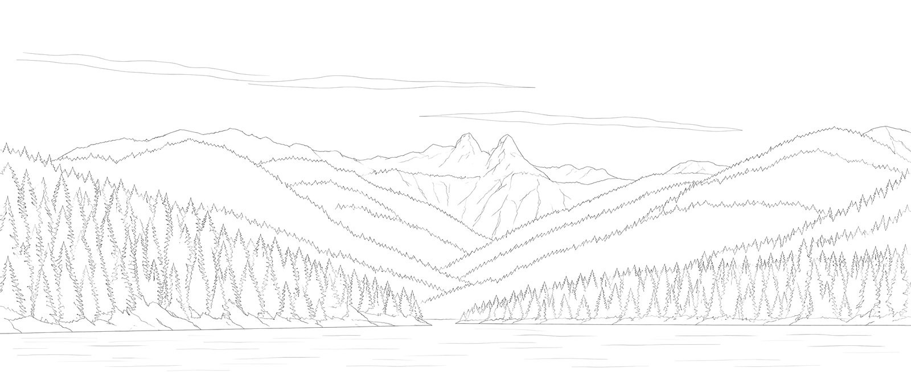

<p align="center">
  
</p>

<h1 align="center">Deep Cove Research Pro</h1>

<p align="center">
  <b>A comprehension engine built on Read-Time Compute.</b><br>
  132 DeepResearch Bench II reports · Written with GPT-5.6 Luna
</p>

<p align="center">
  <a href="#deepresearch-bench-ii">Benchmark</a> · <a href="#model">Model</a> · <a href="#reports">Reports</a> · <a href="#reproducing-the-evaluation">Reproduce</a> · <a href="#team">Team</a> · <a href="#contact">Contact</a>
</p>

Deep Cove Research Pro reads full sources, then turns them into research reports. This repository holds its 132 reports for DeepResearch Bench II: 66 in Chinese and 66 in English.

## DeepResearch Bench II

A benchmark for deep research agents. It has 132 research tasks across 22 themes, each scored against rubric items derived from an expert-written report, covering information recall, analysis and presentation.<sup>[1](#sources)</sup>

## Model

All 132 reports were written with **GPT-5.6 Luna**. Deep Cove Research Pro is a closed-source system; its product page is [deepcove.tech](https://deepcove.tech).

## Reports

The reports follow the benchmark's submission layout: one Markdown file per task, named by the task's `idx` in `tasks_and_rubrics.jsonl`.

```text
deep-cove-research-pro-drb2/
├── README.md
├── report/
│   └── deep-cove-research-pro/
│       ├── idx-1.md
│       ├── idx-2.md
│       ├── …
│       └── idx-132.md
├── SHA256SUMS            checksums of the 132 reports
├── assets/               logo and team picture
├── CITATION.cff          citation metadata
└── LICENSE               terms (proprietary)
```

<details>
<summary>All 132 reports by task</summary>

| idx | Language | Theme | Task |
|:-:|:--|:--|:--|
| [1](report/deep-cove-research-pro/idx-1.md) | Chinese | Finance & Business | A Research Report on the Transformation of China's Local 'Land Finance' Model |
| [2](report/deep-cove-research-pro/idx-2.md) | English | Finance & Business | An Analysis of Social Security Cases in South Asia |
| [3](report/deep-cove-research-pro/idx-3.md) | Chinese | Finance & Business | The issues of social digitalization and population aging in some Asian countries |
| [4](report/deep-cove-research-pro/idx-4.md) | English | Finance & Business | A Detailed Report on the Retirement Savings Gap in Select Asian Countries |
| [5](report/deep-cove-research-pro/idx-5.md) | Chinese | Finance & Business | How many stocks are needed to build an effectively diversified portfolio? |
| [6](report/deep-cove-research-pro/idx-6.md) | English | Finance & Business | Green Bond Policy and Market Research |
| [7](report/deep-cove-research-pro/idx-7.md) | Chinese | Finance & Business | Sovereign Wealth Fund Case Study |
| [8](report/deep-cove-research-pro/idx-8.md) | English | Finance & Business | The performance of gold and silver as safe-haven assets |
| [9](report/deep-cove-research-pro/idx-9.md) | Chinese | Finance & Business | Quantitative analysis of the relationship between US stocks, gold, and crude oil within a 10-year period. |
| [10](report/deep-cove-research-pro/idx-10.md) | English | Finance & Business | Application of Deep Learning Models in Financial Asset Price Prediction |
| [11](report/deep-cove-research-pro/idx-11.md) | Chinese | Finance & Business | A Literature Review of Systemic Financial Risk |
| [12](report/deep-cove-research-pro/idx-12.md) | English | Finance & Business | Research Report on AI-Enhanced Portfolio Management |
| [13](report/deep-cove-research-pro/idx-13.md) | Chinese | Finance & Business | Tabular Analysis of Automated Forklift Technology and Related Products |
| [14](report/deep-cove-research-pro/idx-14.md) | English | Finance & Business | Case Analysis of a Specific Company |
| [15](report/deep-cove-research-pro/idx-15.md) | Chinese | Finance & Business | A Review of the Application of Artificial Intelligence (AI) in Government Decision-Making |
| [16](report/deep-cove-research-pro/idx-16.md) | English | Science & Technology | Research on Materials Inverse Design Technology and Databases |
| [17](report/deep-cove-research-pro/idx-17.md) | Chinese | Science & Technology | A Survey of Atomic Structure-Based Deep Learning Models and Databases |
| [18](report/deep-cove-research-pro/idx-18.md) | English | Science & Technology | Research Status of Horizontal Gene Transfer in Plants |
| [19](report/deep-cove-research-pro/idx-19.md) | Chinese | Science & Technology | Investigation of the Effect of an External Electric Field (EEF) on Tautomeric Molecules |
| [20](report/deep-cove-research-pro/idx-20.md) | English | Science & Technology | An Investigation of the Principle of Cryptochrome in Avian Navigation |
| [21](report/deep-cove-research-pro/idx-21.md) | Chinese | Science & Technology | A review of how animals use environmental factors for orientation. |
| [22](report/deep-cove-research-pro/idx-22.md) | English | Science & Technology | The Life Cycle Cost of Electric Vehicles and Policy Support |
| [23](report/deep-cove-research-pro/idx-23.md) | Chinese | Science & Technology | Solid-State Battery Market Landscape Analysis and Forecast |
| [24](report/deep-cove-research-pro/idx-24.md) | English | Science & Technology | Report on the Recent Surge in Cislunar Space Exploration |
| [25](report/deep-cove-research-pro/idx-25.md) | Chinese | Science & Technology | Performance Investigation of Organic Corrosion Inhibitors for Carbon Steel |
| [26](report/deep-cove-research-pro/idx-26.md) | English | Science & Technology | Research on the Working Principles and Application Fields of Inorganic Corrosion Inhibitors |
| [27](report/deep-cove-research-pro/idx-27.md) | Chinese | Science & Technology | A Review of Stock Assessment Models for the Fishery Resource Status of Chub Mackerel in the Northwest Pacific Ocean. |
| [28](report/deep-cove-research-pro/idx-28.md) | English | Science & Technology | Comparative Analysis of Pumps as Turbines (PATs) and Other Hydraulic Turbines |
| [29](report/deep-cove-research-pro/idx-29.md) | Chinese | Science & Technology | An Overview of Integrated Photonic Platforms for the Field of Quantum Technology |
| [30](report/deep-cove-research-pro/idx-30.md) | English | Science & Technology | A Review of the Applications of Artificial Intelligence in PET Imaging |
| [31](report/deep-cove-research-pro/idx-31.md) | Chinese | Science & Technology | Comparative Analysis of Different Mobile Radiation Monitoring Platforms |
| [32](report/deep-cove-research-pro/idx-32.md) | English | Science & Technology | Research on Lithium Niobate (LiNbO₃) Single Crystal and Related Materials |
| [33](report/deep-cove-research-pro/idx-33.md) | Chinese | Science & Technology | A Survey of Quantum Simulator Technology |
| [34](report/deep-cove-research-pro/idx-34.md) | English | Science & Technology | Drone Autopilot Product Research |
| [35](report/deep-cove-research-pro/idx-35.md) | Chinese | Science & Technology | Survey of Quadrotor UAV Control Methods |
| [36](report/deep-cove-research-pro/idx-36.md) | English | Science & Technology | A Survey on the Current Status of Quantum Technology Standardization |
| [37](report/deep-cove-research-pro/idx-37.md) | Chinese | Science & Technology | A Review of Self-Testing Methods for Many-Body Quantum States |
| [38](report/deep-cove-research-pro/idx-38.md) | English | Science & Technology | A Review of Environmental Control Algorithms Used in Modern Agricultural Greenhouses |
| [39](report/deep-cove-research-pro/idx-39.md) | Chinese | Software Development | A Survey of Vision-Based Contactless Vital Signs Monitoring Technology |
| [40](report/deep-cove-research-pro/idx-40.md) | English | Software Development | Attack and Defense Methods for Wi-Fi Sensing Technology |
| [41](report/deep-cove-research-pro/idx-41.md) | Chinese | Software Development | Low-code Development Market and Technology Research (Pre-2021) |
| [42](report/deep-cove-research-pro/idx-42.md) | English | Software Development | Survey on the Impact of Low-Code Platforms and Their Applications (2025) |
| [43](report/deep-cove-research-pro/idx-43.md) | Chinese | Software Development | A Survey of Population-Based Deep Reinforcement Learning |
| [44](report/deep-cove-research-pro/idx-44.md) | English | Software Development | A Survey of Convex Optimization Methods in Autonomous Flying Vehicles |
| [45](report/deep-cove-research-pro/idx-45.md) | Chinese | Software Development | A Survey of AI-focused Kubernetes Scheduling Algorithms |
| [46](report/deep-cove-research-pro/idx-46.md) | English | Software Development | Research on Auto-Scaling Technology in Cloud Computing |
| [47](report/deep-cove-research-pro/idx-47.md) | Chinese | Software Development | Observability in Modern Distributed Management Systems and Its Solutions |
| [48](report/deep-cove-research-pro/idx-48.md) | English | Software Development | An Analysis of the Concepts of Big Loop and Atomization in AI Research |
| [49](report/deep-cove-research-pro/idx-49.md) | Chinese | Software Development | A Technical Survey of HTTP Adaptive Streaming Video Encoding and Consumption-side Algorithms |
| [50](report/deep-cove-research-pro/idx-50.md) | English | Software Development | Research on Content Caching Strategies for MEC-Assisted Video |
| [51](report/deep-cove-research-pro/idx-51.md) | Chinese | Software Development | A Detailed Comparison Report of Current Mainstream Web Development Frameworks |
| [52](report/deep-cove-research-pro/idx-52.md) | English | Education & Jobs | A Comprehensive Report on the Opportunities and Challenges of Applying Generative AI in Education. |
| [53](report/deep-cove-research-pro/idx-53.md) | Chinese | Education & Jobs | *(no title in the task file; topic: learning analytics in higher education)* |
| [54](report/deep-cove-research-pro/idx-54.md) | English | Education & Jobs | An Overview of AI Tools Providing Writing Scaffolds for K-12 English Students |
| [55](report/deep-cove-research-pro/idx-55.md) | Chinese | Education & Jobs | The social security situation of cultural and creative practitioners in atypical employment relationships in different countries |
| [56](report/deep-cove-research-pro/idx-56.md) | English | Education & Jobs | A Review of the Impact of Generative Artificial Intelligence on the Labor Market |
| [57](report/deep-cove-research-pro/idx-57.md) | Chinese | Education & Jobs | Research on the Impact of Industry 4.0 on the Labor Market in South Asia |
| [58](report/deep-cove-research-pro/idx-58.md) | English | Education & Jobs | A Review of the Effectiveness of Online Learning in Higher Education during COVID-19 |
| [59](report/deep-cove-research-pro/idx-59.md) | Chinese | Education & Jobs | The Current State of Research on the Application of ChatGPT in Education (2023) |
| [60](report/deep-cove-research-pro/idx-60.md) | English | Education & Jobs | Research on the Causes of and Solutions for Anxiety in Students with Autism |
| [61](report/deep-cove-research-pro/idx-61.md) | Chinese | Education & Jobs | Artificial Intelligence Tutoring Systems for K-12 Education |
| [62](report/deep-cove-research-pro/idx-62.md) | English | Health | Effect of salt substitutes on cardiovascular risk |
| [63](report/deep-cove-research-pro/idx-63.md) | Chinese | Health | An Investigation of Potential Therapeutic Strategies to Reverse T-Cell Exhaustion by Regulating Mitochondrial Metabolism |
| [64](report/deep-cove-research-pro/idx-64.md) | English | Health | Different technical pathways for the isolation or generation of exhausted T cells. |
| [65](report/deep-cove-research-pro/idx-65.md) | Chinese | Health | The Relationship Between Zinc Homeostasis and Cardiovascular Disease (CVD) |
| [66](report/deep-cove-research-pro/idx-66.md) | English | Health | A Review of the Interactions between Gut Microbiota and Different CRC Therapies |
| [67](report/deep-cove-research-pro/idx-67.md) | Chinese | Health | Investigation of the effects of m⁶A on the immune system |
| [68](report/deep-cove-research-pro/idx-68.md) | English | Health | Conceptual Analysis of AI-Assisted Shared Decision-Making in Healthcare |
| [69](report/deep-cove-research-pro/idx-69.md) | Chinese | Health | Research on Artificial Intelligence in the Field of Mental Health |
| [70](report/deep-cove-research-pro/idx-70.md) | English | Health | Applications of Digital Twins in Healthcare |
| [71](report/deep-cove-research-pro/idx-71.md) | Chinese | Health | The psychology of conspiracy theories |
| [72](report/deep-cove-research-pro/idx-72.md) | English | Health | Temporal Evolution of Parkinson's Diagnostic Criteria |
| [73](report/deep-cove-research-pro/idx-73.md) | Chinese | Health | A Survey of Knowledge Graphs for Drug Repurposing |
| [74](report/deep-cove-research-pro/idx-74.md) | English | Literature | Policies and Practices of Open Research Data in China |
| [75](report/deep-cove-research-pro/idx-75.md) | Chinese | Literature | An Analysis of the Theoretical Innovations Represented by *The Cambridge History of Chinese Literature* |
| [76](report/deep-cove-research-pro/idx-76.md) | English | Literature | Research on the Relationship between International Organizations and Decolonization in the 20th Century |
| [77](report/deep-cove-research-pro/idx-77.md) | Chinese | Literature | Transgender rights and legal status in Egypt |
| [78](report/deep-cove-research-pro/idx-78.md) | English | Literature | Academic Study of Japanese Anime and Manga |
| [79](report/deep-cove-research-pro/idx-79.md) | Chinese | Literature | A Study on LGBTQ+ Inclusivity in Japanese Textbooks and Teaching Methods |
| [80](report/deep-cove-research-pro/idx-80.md) | English | History | Memory Politics of Eastern Europe, Trauma Theory, and Postcolonialism |
| [81](report/deep-cove-research-pro/idx-81.md) | Chinese | History | Applications of Augmented Reality Technology in History Education and Cultural Heritage Visualization |
| [82](report/deep-cove-research-pro/idx-82.md) | English | History | The Rear-Area Factory Construction of the Nationalist Government's National Resources Commission during the Second Sino-Japanese War |
| [83](report/deep-cove-research-pro/idx-83.md) | Chinese | History | Research and review of the concepts of collective memory and social memory |
| [84](report/deep-cove-research-pro/idx-84.md) | English | History | How oil-dependent countries manage their wealth to avoid the "resource curse" |
| [85](report/deep-cove-research-pro/idx-85.md) | Chinese | History | A Study of Three East Asian Films on the Theme of Post-World War II Trials |
| [86](report/deep-cove-research-pro/idx-86.md) | English | Hardware | Technology Survey Report on Alternative Metals for Advanced Semiconductor Interconnects |
| [87](report/deep-cove-research-pro/idx-87.md) | Chinese | Hardware | New Advances in Interconnect Technology for Semiconductor Chips |
| [88](report/deep-cove-research-pro/idx-88.md) | English | Hardware | Engineering strategies for reducing contact resistance in 2D FETs |
| [89](report/deep-cove-research-pro/idx-89.md) | Chinese | Hardware | Detailed Research Report on BLIK in Poland |
| [90](report/deep-cove-research-pro/idx-90.md) | English | Hardware | Challenges and Solutions for SRAM Operating Under Low Voltage |
| [91](report/deep-cove-research-pro/idx-91.md) | Chinese | Hardware | A Survey of SRAM Sensing Circuits for Offset Reduction |
| [92](report/deep-cove-research-pro/idx-92.md) | English | Industrial | A Literature Review of Integrated Urban Water Management Models |
| [93](report/deep-cove-research-pro/idx-93.md) | Chinese | Industrial | Research on Vibration-Based Condition Monitoring of Heavy Machinery |
| [94](report/deep-cove-research-pro/idx-94.md) | English | Industrial | An Analysis of the Piped Drinking Water Situation and Inequality in Zambia |
| [95](report/deep-cove-research-pro/idx-95.md) | Chinese | Industrial | Investigation of Hydroforming Technology |
| [96](report/deep-cove-research-pro/idx-96.md) | English | Industrial | Production scheduling algorithm for "High-Mix, Low-Volume" (HMLV) production mode |
| [97](report/deep-cove-research-pro/idx-97.md) | Chinese | Art & Design | Immersive Van Gogh Art Exhibition Research |
| [98](report/deep-cove-research-pro/idx-98.md) | English | Art & Design | A Study of the Educational Work of Jazz Pianist Mary Lou Williams in Her Later Years |
| [99](report/deep-cove-research-pro/idx-99.md) | Chinese | Art & Design | An In-depth Study of Netflix's Global Content Production Strategy |
| [100](report/deep-cove-research-pro/idx-100.md) | English | Art & Design | Research Report on Generative AI Copyright Issues |
| [101](report/deep-cove-research-pro/idx-101.md) | Chinese | Games | Game Design Methodology Research |
| [102](report/deep-cove-research-pro/idx-102.md) | English | Games | The impact of esports and online games on health |
| [103](report/deep-cove-research-pro/idx-103.md) | Chinese | Crime & Law | Legal Research on Traffic Accident Liability for German Autonomous Vehicles |
| [104](report/deep-cove-research-pro/idx-104.md) | English | Crime & Law | China's Policies on Organ Transplantation and Organs from Executed Prisoners |
| [105](report/deep-cove-research-pro/idx-105.md) | Chinese | Entertainment | Plot Analysis of Japanese Isekai Manga |
| [106](report/deep-cove-research-pro/idx-106.md) | English | Entertainment | A Commercial and Cultural Analysis of the Film "Ne Zha" |
| [107](report/deep-cove-research-pro/idx-107.md) | Chinese | Transportation | The development of urban rail transit in mainland China from 2015 to 2023 |
| [108](report/deep-cove-research-pro/idx-108.md) | English | Transportation | Research on Materials for the Pantograph-Catenary Power Supply System of High-Speed Trains |
| [109](report/deep-cove-research-pro/idx-109.md) | Chinese | Transportation | Survey of Communication Systems in Smart Railways |
| [110](report/deep-cove-research-pro/idx-110.md) | English | Sports & Fitness | The effect of physical exercise on the health of Chinese children and adolescents aged 6 to 17 |
| [111](report/deep-cove-research-pro/idx-111.md) | Chinese | Sports & Fitness | A Review of Physical Activity and Sedentary Behavior among In-School Adolescents in Low- and Middle-Income Countries |
| [112](report/deep-cove-research-pro/idx-112.md) | English | Sports & Fitness | A Review of Video Activity Recognition Technology |
| [113](report/deep-cove-research-pro/idx-113.md) | Chinese | Software | A Survey on the Practical Applications of Artificial Intelligence (AI) in Software Engineering |
| [114](report/deep-cove-research-pro/idx-114.md) | English | Software | Competitive landscape of the public cloud computing service market |
| [115](report/deep-cove-research-pro/idx-115.md) | Chinese | Religion | A Study of the Taoist Thought on Longevity and Immortality |
| [116](report/deep-cove-research-pro/idx-116.md) | English | Religion | Analyzing the Quran through Western contemporary philosophy of art. |
| [117](report/deep-cove-research-pro/idx-117.md) | Chinese | Religion | The views of the eminent Sui Dynasty monk Jizang on 'Buddha-nature'. |
| [118](report/deep-cove-research-pro/idx-118.md) | English | Religion | Narratives of "Motherhood" in the Hebrew Bible (Old Testament) |
| [119](report/deep-cove-research-pro/idx-119.md) | Chinese | Travel | The Impact of Temperature and Precipitation on Major Outdoor Recreational Activities in the United States |
| [120](report/deep-cove-research-pro/idx-120.md) | English | Travel | An Analysis of Tourism in Northern Mediterranean Countries from 2010 to 2020 |
| [121](report/deep-cove-research-pro/idx-121.md) | Chinese | Travel | The relationship between airport construction and regional economic development |
| [122](report/deep-cove-research-pro/idx-122.md) | English | Home & Hobbies | Research on Climate-Adaptive Housing |
| [123](report/deep-cove-research-pro/idx-123.md) | Chinese | Home & Hobbies | A Study of Housing Informality |
| [124](report/deep-cove-research-pro/idx-124.md) | English | Home & Hobbies | Research on the Applications of the Internet of Things |
| [125](report/deep-cove-research-pro/idx-125.md) | Chinese | Social Life | The Impact of Recess on the Educational Outcomes of Elementary School Students |
| [126](report/deep-cove-research-pro/idx-126.md) | English | Social Life | The effectiveness of the 24-Hour Movement Guidelines in children and adolescents |
| [127](report/deep-cove-research-pro/idx-127.md) | Chinese | Social Life | "Pseudo-Intimate Relationships" in the Context of Human-Computer Interaction |
| [128](report/deep-cove-research-pro/idx-128.md) | English | Food & Dining | Report on the Impact of Protein Intake on Muscle and Bone Health in Older Adults |
| [129](report/deep-cove-research-pro/idx-129.md) | Chinese | Food & Dining | Technical Research on Lowering the Alcohol Content of Wine |
| [130](report/deep-cove-research-pro/idx-130.md) | English | Food & Dining | Comparison of Common Sugar Substitutes |
| [131](report/deep-cove-research-pro/idx-131.md) | Chinese | Fashion & Beauty | Statistical Analysis of the Demographic Profile of the U.S. Orthodontic Population |
| [132](report/deep-cove-research-pro/idx-132.md) | English | Fashion & Beauty | A Detailed Report on Treatment Methods for Melasma |

</details>

### Report statistics

<div align="center">

| | Chinese reports (66) | English reports (66) |
|:--|:-:|:-:|
| Median length | 170,433 characters | 20,332 words |
| Median distinct sources cited | 449 | 258 |
| Reports with tables | 66 of 66 | 66 of 66 |

**45,329** distinct sources cited across all 132 reports.

</div>

## Reproducing the evaluation

1. Get the official evaluation code from the [DeepResearch Bench II repository](https://github.com/imlrz/DeepResearch-Bench-II) at commit `7c7a9a8` and set up its `.env` as its README describes, keeping the default GPT-5.5 evaluator settings.
2. Copy this repository's `report/deep-cove-research-pro` folder into a new empty folder, for example `submissions/`, inside the benchmark folder. The checksums are in [SHA256SUMS](SHA256SUMS).
3. From the benchmark folder, run the evaluator and the aggregation:

```bash
python run_evaluation.py --pdf_dir submissions --out_jsonl result.jsonl --chunk_size 50
python aggregate_scores.py --input result.jsonl --tasks-file tasks_and_rubrics.jsonl
```

The per-task and overall scores are written to the `agg_scores_*.csv` files.

## Team

### Built in North Vancouver

Deep Cove Research is a stealth team based in North Vancouver, British Columbia. We build the comprehension engine and test it in public, on DeepResearch Bench and DeepResearch Bench II.

<p align="center">
  <picture>
    <source media="(prefers-color-scheme: dark)" srcset="assets/team-the-lions-dark.jpg">
    
  </picture>
</p>

<p align="right"><sub>The Lions from Capilano Lake, North Vancouver</sub></p>

## Contact

**Early access.** Deep Cove Research is opening in stages. To request an invitation for your team, email us.

- **Website:** [deepcove.tech](https://deepcove.tech)
- **Email:** [hello@deepcove.tech](mailto:hello@deepcove.tech)
- **Phone:** +1 (604) 764 6576
- **Address:** North Vancouver, British Columbia

## Citation

If you refer to these reports, please cite this repository:

```bibtex
@misc{deepcoveresearchprodrb2_2026,
  title = {Deep Cove Research Pro: DeepResearch Bench II Reports},
  author = {{Deep Cove Research}},
  year = {2026},
  howpublished = {\url{https://github.com/aldrinor/deep-cove-research-pro-drb2}},
  note = {132 reports (66 Chinese, 66 English)},
}
```

Please also cite the benchmark: Li et al., [*DeepResearch Bench II: Diagnosing Deep Research Agents via Rubrics from Expert Reports*](https://arxiv.org/abs/2601.08536), 2026.

## License

Proprietary. The reports in this repository are © 2026 Deep Cove Research, all rights reserved; see [LICENSE](LICENSE). The task titles and themes listed above are part of DeepResearch Bench II and follow its per-task licenses.

## Sources

1. **DeepResearch Bench II paper and repository.** arXiv 2601.08536; 132 tasks with rubric items derived from expert-written reports.

## Acknowledgements

We thank the DeepResearch Bench II team (Ruizhe Li, Mingxuan Du, Benfeng Xu, Chiwei Zhu, Xiaorui Wang and Zhendong Mao) for the benchmark, its official evaluation code and the leaderboard.
